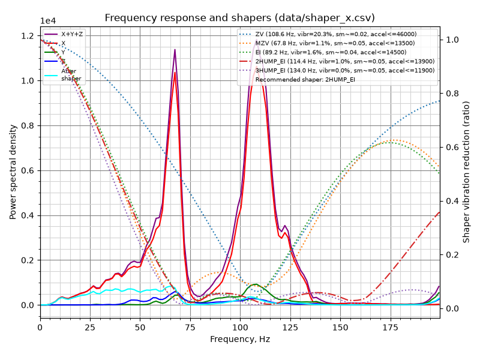
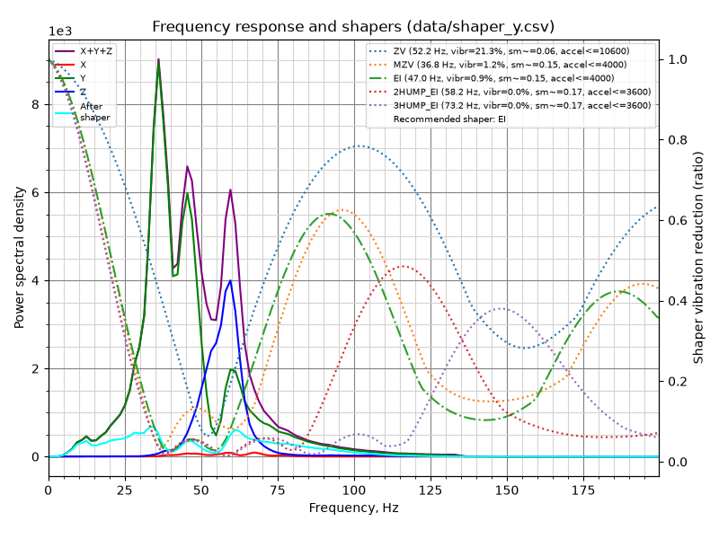

# Input shaper results — 2026-10-22

Sensor: BTT LIS2DW v1.0 (USB RP2040), Klipper v0.13.0-816. Graphs rendered with Klipper's `scripts/calibrate_shaper.py`.
Raw data is stored as `*.csv.txt` because the backup rules exclude `*.csv` files.

| Axis | Sensor mount | Peaks | Recommended | Max accel (smoothing limit) |
|---|---|---|---|---|
| X | Toolhead: on the nozzle, between silicone washers | 67 Hz and 108 Hz (smaller ones at 47 and 122 Hz) | **2hump_ei @ 114.4 Hz** (1.0% vibration, smoothing 0.045) | ~13,900 mm/s² |
| Y | Taped to the bed | ~36 Hz main, ~46 Hz second | **ei @ 47.0 Hz** (0.9% vibration, smoothing 0.149) | ~4,000 mm/s² |

- **Y was run twice.** The first run (`calibration_data_y_run1_frame-obstructed.csv.txt`) had the frame resting on an object, which was removed partway through. It still gave ei @ 49.4 Hz, close to the clean re-run, which is the one saved.
- **Previous values:** X mzv @ 78 Hz and Y mzv @ 29.4 Hz. The old Y value was most likely measured with the sensor on the toolhead, which is wrong for a bed-slinger.
- **Result applied:** `max_accel` lowered from 8000 to 4000.
- **X caveat:** the nozzle mount with silicone washers is slightly compliant. Re-run X with a rigid toolhead mount if X ringing shows up.

